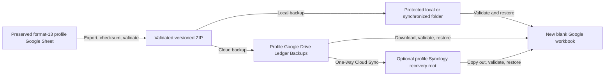

# Backup and recovery

This is the operator guide for creating, validating, copying, and restoring
preserved format-13 Sheets backups. Backups are recovery artifacts, not alternate
live ledgers. Sheets archive restoration targets a new blank Google workbook and
refuses every configured live workbook.

For an activated PostgreSQL entity, the [bookkeeping cutover
guide](accounting/CUTOVER.md) defines the bounded rollback to its preserved format-13
Sheets source. After committed PostgreSQL writes, recover PostgreSQL through managed
database recovery and platform operations backup/PITR procedures and coordinate
Document-byte recovery. The preserved Sheet and these ZIP backups cannot become a live
fallback to a diverged PostgreSQL ledger.

## Recovery topology



For these Sheets archives, Google Drive is the cloud destination; local storage
and Synology are additional failure boundaries. Current bookkeeping recovery uses
the separate [PostgreSQL recovery](operations/DATABASE_RECOVERY.md),
[NAS SQL archive](operations/NAS_BACKUP.md) and
[document-byte recovery](storage/RECEIPT_RECOVERY.md) procedures. Neither a Sheets
ZIP nor a PostgreSQL dump contains the external receipt bytes.

## Archive format and safety

The only supported Sheets archive is frozen at format 13. Exact worksheet
headers, ZIP members, manifest requirements, and relationships live in
[Final Sheets source contract](SHEETS_SOURCE_CONTRACT.md).

The archive includes a profile-scoped receipt metadata inventory; receipt bytes
remain in the document store or its recovery copy, outside the ledger ZIP.

Current-format backups require the selected profile's configured Drive receipt
folder. Immediately before creation, the command-line tools refresh
Sheets and Drive, backfill missing receipt integrity metadata, and reconcile
only references already present in the current workbook. They do not infer
historical associations from Drive metadata. If preparation or validation is
incomplete, no backup is created.

The old Drive-only receipt-association converter is retired. Current backups preserve
explicit workbook receipt relationships and intentional unlinks. They do not infer
missing relationships from Drive properties. Use an approved source correction before
freeze/acceptance if required; live PostgreSQL corrections and document recovery use
their supported owners. Preserve all existing source and recovery artifacts.


The application validator and restore path accept **only format 13**. Every other
archive format is rejected before target initialization or writes. Historical converters
are retired. Preserve an unsupported archive privately; select a validated format-13
generation for supported recovery. The application does not delete old archives,
receipts, ledgers, or accounting history as part of retirement. Backup-file retention is
an operational policy owned by platform operations.

Mixed-use source/projection, recurring occurrence, depreciation, journal, and
receipt relationships are validated under the shared source contract. Restore
retains their existing identities and complete supported bookkeeping history.

## Backup operating modes

The Streamlit Data & backup page is retired. Browser Data & backup provides the
supported financial CSV and canonical PostgreSQL export workflows; operational
PostgreSQL/database and document-byte backups follow [NAS backup](operations/NAS_BACKUP.md)
and [receipt recovery](storage/RECEIPT_RECOVERY.md).

The explicit Sheets CLI commands below remain available for approved format-13
source/archive preservation and recovery. They do not reactivate Sheets bookkeeping
or change the frozen-source/divergence boundary. The local operator CLI retains
recovery configuration and Google target authorization.


## Command-line backup

Create a protected local archive:

```powershell
python scripts\backup_google_sheets.py --profile PROFILE_KEY --local-dir backups\PROFILE_KEY --keep 30
```

The `--local-dir` switch selects local mode. Use it without a path to select the
profile's configured `backup_folder_path` or the ignored fallback
`backups/PROFILE_KEY/`; provide a path after the switch to override that
location. Without `--local-dir`, the command uses Google Drive. Single-profile
commands use a configured path exactly. The command validates before success,
uses a new timestamped filename, never overwrites an archive, and retains the
newest requested generations.

Create a Google Drive backup after the profile has a valid Drive grant and ledger
Backups folder:

```powershell
python scripts\backup_google_sheets.py --profile PROFILE_KEY --keep 30
```

Google Drive is the default destination; --google-drive is an explicit
equivalent. The uploader uses the profile refresh token and backup folder,
records the archive hash and profile in private app-properties, makes
uncertain retries idempotent, and applies retention to app-managed archives.
Google Drive Desktop is not required.

The keep value must be at least 2 and defaults to 30. Backups contain private
ledger data and must never be committed.

## Manual all-profile preservation

The explicit command evaluates each profile independently; a failure for one
profile does not prevent later profiles from running. It remains available for
approved source/archive preservation, independently of Windows scheduling.

All-profile cloud backup:

```powershell
python scripts\backup_google_sheets.py --all-profiles --google-drive --keep 30
```

All-profile local backup:

```powershell
python scripts\backup_google_sheets.py --all-profiles --local-dir --keep 30
```

## Retired Windows task installation

The Windows weekly Sheets-backup task installer is retired. New protection for
PostgreSQL bookkeeping follows the NAS SQL and separate document-byte procedures
linked above. Retiring the installer does not replace archive readers, receipt
remapping or the manual preservation commands, and establishes no document backup
schedule or new recovery guarantee.

Removing installer source changes no installed task. Other installations may still
have `Project Tabula Rasa Weekly Backup`, `Project Tabula Rasa Weekly Local Backup`,
`Tabula Rosa Weekly Backup` or a custom task name. An absent default task on one
machine does not establish their absence elsewhere. Inventory their command,
checkout, account, profile and destination before separately authorizing any
scheduler change. Keep old writers stopped and divergent sources frozen; a task
must not be treated as current PostgreSQL protection. Backup preparation can update
Sheets receipt references and Drive integrity metadata, so it is not a read-only
operation on a frozen source.

The backup CLI retains `--all-profiles` and `--once-per-week` compatibility for
existing invocations. A verified format-13 archive for the selected profile in the
current local ISO week suppresses another weekly attempt. Local all-profile mode
uses separate profile destinations; an explicit `--local-dir PATH` requires a
single profile. This compatibility does not install, enable, disable or remove tasks.

## Validate an archive

Validate every copied or downloaded archive before relying on it:

```powershell
python scripts\validate_google_sheets_backup.py "C:\Safe-Recovery\tabula-rasa-backup-YYYYMMDDTHHMMSSZ.zip"
```

The current validator accepts only format 13. Successful validation confirms a
format-13 archive's exact ZIP structure, manifest integrity, headers,
checksums, row counts, IDs, ledger relationships,
and the receipt inventory's profile, identities, filenames, sizes, checksums,
duplicates, and transaction associations. Journal parent and posting
identities, ordering, balance, typed targets, and managed references are also
validated. Non-13 archives are unsupported; preserve them privately and use
a validated format-13 recovery generation.

Do not modify a failed archive. Preserve it privately, choose another
generation, and validate again.

## Restore into a new blank workbook

1. Create a new blank Google spreadsheet.
2. Give the selected profile's Google account Editor access and authorize the
   blank target with `python -m scripts.local_profile_admin workbook authorize PROFILE_KEY`.
   Copy the ID reported in the terminal.
3. Validate the archive locally and restore it with:

   ```powershell
   python scripts\restore_google_sheets_backup.py "C:\Safe-Recovery\tabula-rasa-backup-YYYYMMDDTHHMMSSZ.zip" --profile PROFILE_KEY --target-spreadsheet-id NEW_SPREADSHEET_ID --initialize
   ```

The restore validates before writing, refuses every configured live workbook,
refuses populated or incompatible target worksheets, initializes missing
headers when requested, restores all supported tables, and rereads the target
to verify rows.

Validate the new workbook through the normal profile path without changing the
configured business:

```powershell
python scripts\validate_google_sheets.py --profile PROFILE_KEY --spreadsheet-id NEW_SPREADSHEET_ID
```

This override is read-only and reports the workbook title and sanitized row
counts. It cannot be combined with --write-test. Spot-check headers and
representative relationships, then delete or clearly label the drill workbook.

## Recover receipt bytes and remap Drive IDs

Ledger restoration does not restore receipt bytes. Using a validated format-13
archive, copy the matching profile Receipts directory from the protected
Synology recovery set to a safe local path, then recover against the new
workbook:

```powershell
python scripts\recover_synology_receipts.py "C:\Safe-Recovery\tabula-rasa-backup-YYYYMMDDTHHMMSSZ-format13.zip" "C:\Safe-Recovery\Receipts" --profile PROFILE_KEY --target-spreadsheet-id NEW_SPREADSHEET_ID
```

The command refuses every configured live workbook. Before a Drive change it
validates the archive, confirms the receipt inventory belongs to the selected
profile, and checks referenced transactions in the restored target. Each file
is checked for size and SHA-256. Stored filenames, stable identity, integrity
metadata, and provenance are preserved while old diagnostic Drive IDs are
remapped to confirmed new IDs.

Retries identify files by stable receipt identity and checksum. A matching
Drive file is downloaded and verified before reuse. Unreferenced files are
restored without attachment. Missing, corrupt, conflicting, and failed entries
are counted and skipped while valid entries continue.

Receipt-reference reconciliation is bounded optimistic concurrency. The
initial fresh Transactions snapshot is only a planning cache. Before any
cached skip or ledger write, a second full snapshot must match every live
transaction ID and receipt-reference cell. If state changed, the plan is
recomputed from the new snapshot for at most three attempts. A stable plan
updates only affected receipt-reference cells in one batch. An uncertain
batch response is read back and the whole plan is recomputed before another
write; the same batch is never blindly resubmitted.

The recovery order is:

1. Restore the archive into a new blank workbook.
2. Connect or confirm the selected profile's receipt folder.
3. Recover bytes from the matching Synology version.
4. Verify referenced receipts through remapped Drive IDs.
5. Verify unreferenced receipts remain available without automatic attachment.

Supported receipt recovery requires a validated format-13 archive and the
matching profile inventory. Earlier archive formats are rejected before any
Drive upload or target-ledger change.

## PostgreSQL transition and operational recovery

Sheets migration framework extracts only the frozen format-13 live Sheets source;
whole-profile acceptance verifies whole-profile reconciliation and source-format
rejection. authority cutover requires frozen Sheets source contract's retirement
evidence, whole-profile acceptance, and complete entity export's verified complete
per-entity export before migrated-entity activation. Preserve the pre-cutover Sheets
source unchanged; rollback to it is available only before divergent PostgreSQL writes
make it stale.

After divergence, PostgreSQL managed backup/PITR and recovery-point schema validation
use [managed database recovery's managed recovery
runbook](operations/DATABASE_RECOVERY.md), with platform operations owning ongoing
operations and document-store recovery. Commercial production activation requires
successful real restore and requested-point PITR evidence. complete entity export's
canonical export has its own version and accounting model; it is neither a format-13
Sheets archive nor a replacement for disaster recovery. These downstream capabilities
remain work; retiring historical Sheets formats does not implement them.

## Optional Synology recovery copy

Synology is a second recovery boundary. The current supported topology is one
recursive Cloud Sync download task per opted-in profile:

- remote source: the profile's Drive storage root;
- expected children: Receipts and Ledger Backups;
- local destination: a distinct profile-specific NAS root;
- direction: Download remote changes only; and
- destination deletions: disabled.

Project Tabula Rasa records the expected destination, schedule, and retention
policy but does not connect to DSM, configure Cloud Sync, or prove transfer
health. DSM logs are the source of truth. The NAS may continue synchronizing
while the app and Windows computer are offline.

### Prepare the NAS

1. In DSM, create a protected shared folder such as Tabula_Rasa_Backups with
   sufficient capacity.
2. Give only the Cloud Sync service and required administrators access; use
   explicit permissions and review DSM's effective Preview values.
3. Create one non-overlapping subfolder per profile, for example:

   ```text
   /volume1/Tabula_Rasa_Backups/business-name1
   /volume1/Tabula_Rasa_Backups/business-name2
   ```

4. Protect DSM administrator access with strong credentials and MFA. If
   shared-folder encryption is used, keep its recovery material outside the
   NAS and test remounting after a reboot.

Each enabled profile must have a distinct destination. The app rejects
equivalent, shared, or nested normalized NAS paths.

### Record a profile's recovery settings

Use the local operator CLI after provisioning the profile's Drive root and children.

```text
python -m scripts.local_profile_admin recovery set PROFILE_KEY
python -m scripts.local_profile_admin recovery show PROFILE_KEY
```

Review the derived profile destination, schedule and retention policy. Override
them with `--destination`, `--schedule` and `--retention` when needed.
The command records the profile-root layout. Use `recovery disable PROFILE_KEY`
to remove the local record.

Optional app-wide defaults belong only in local secrets:

```toml
[synology_recovery_defaults]
base_path = "/volume1/Tabula_Rasa_Backups"
schedule = "Continuous"
retention_policy = "Retain all synchronized generations until quarterly manual review."
```

The base path is never used directly as a destination; the profile key is
appended. Saving this record changes local metadata only. Disabling it removes
the record but does not delete a DSM task or NAS archive.

Use `recovery show` for the saved local settings and DSM Cloud Sync logs for
actual sync health.

### Configure Cloud Sync

Authorize Cloud Sync with the Google account that owns the profile's Drive
storage root. Do not use a Shared with me item, shortcut, Computers location,
or unsupported Workspace Shared Drive.

Create one task for each profile:

| Setting | Required value |
| --- | --- |
| Provider | Google Drive |
| Remote path | Profile storage root containing Receipts and Ledger Backups |
| Local path | Matching profile-specific NAS root |
| Direction | Download remote changes only |
| Destination deletions | Do not remove destination files when removed from source |
| Schedule | Saved profile schedule |
| Google document conversion | Disabled |

Inspect both source and destination. Ledger Backups should contain only
timestamped tabula-rasa-backup-YYYYMMDDTHHMMSSZ.zip files; Receipts contains
the app-managed receipt files. Do not place credentials, exported Secrets,
temporary CSVs, or unrelated files in these folders. Destination-deletion
protection intentionally retains old NAS archives and unlinked receipts after
Drive retention removes source files.

### First-copy and retry check

Create a fresh verified Drive backup, wait for Cloud Sync to report current,
confirm both children arrived, and copy an archive to a safe local recovery
folder. Never restore or validate a partially synchronized file.

For a basic retry drill, let two generations synchronize, confirm both remain,
pause the task, upload another verified backup, confirm DSM shows the task is
paused or not current, resume it, and confirm the pending archive arrives
intact. Review the DSM log.

## Retention and recovery evidence

Google Drive and command-line modes retain the newest 30 app-managed
generations by default. Retention deletes only canonical app-managed backup
files and requires at least two generations. Synology destination deletion is
disabled; apply any manual NAS retention only after validating another
generation and keeping the recovery periods still needed.

Keep a private record of the profile key, archive name and time, validator
result, storage location, restore command output, recovery workbook ID, receipt
recovery result, drill date, and administrator. Do not put credentials, private
ledger data, full account addresses, or identifiers in GitHub or the repository.

Application credentials and configuration are not in backup archives. Rebuild
after a deployment loss by restoring protected app and profile configuration,
validating each workbook, reconnecting unavailable Drive grants, confirming
storage roots and children, and validating a current backup. Commercial grants
require separate approved encrypted provisioning; Streamlit Cloud Secrets export
is retired.

## Troubleshooting

### The scheduled task creates no backup

Confirm the Windows account, virtual environment, profile key, destination,
Drive grant, and selected backup folder. In all-profile mode, inspect the
sanitized per-profile status.

### A weekly backup is skipped

That is expected when a valid current-format archive with a verified receipt
inventory already exists in the current local ISO week.

### Cloud authorization cannot refresh

Reconnect with `python -m scripts.local_profile_admin google connect PROFILE_KEY`,
confirm the folders, and retry.
For commercial grants, follow [connection staging](identity/CONNECTIONS_AND_CLAIMS.md)
and Owner confirmation separately.

### Restore refuses the target

Create a new blank workbook, share it with the selected profile's Sheets
Google account and authorize it with `python -m scripts.local_profile_admin workbook authorize PROFILE_KEY`, verify the target is not any configured live workbook, and
use `--initialize`.

### An archive fails validation

Do not restore or alter it. Preserve the copy, confirm synchronization had
completed, choose another generation, and validate again.

### Receipt recovery reports missing or corrupt entries

Confirm the matching protected NAS version and completed Cloud Sync. Do not
rename files or copy them blindly into Drive. Correct the recovery copy and
retry; identity and checksum rules prevent unnecessary duplicate uploads.

## Implementation map

| Responsibility | Implementation |
| --- | --- |
| Backup format and storage validation | `tabula_rasa/storage/google_sheets/backup.py` and `validation.py` |
| Local and Drive backup command | scripts/backup_google_sheets.py |
| Archive validation | scripts/validate_google_sheets_backup.py |
| Workbook restore | scripts/restore_google_sheets_backup.py |
| Receipt preparation and manifest | tabula_rasa/receipt_backfill.py and tabula_rasa/receipt_manifest.py |
| Receipt recovery and Drive-ID remapping | scripts/recover_synology_receipts.py and tabula_rasa/receipt_recovery.py |
