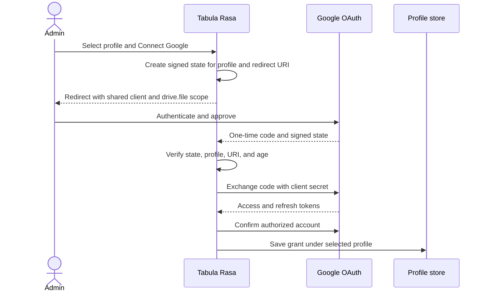
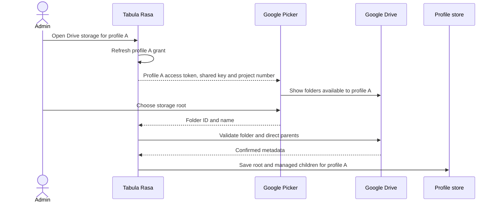

# Google Drive

This guide configures Google Cloud, OAuth, Google Picker, and the per-profile
Google connection used for Sheets ledgers, receipts, and cloud backups. The
same profile OAuth grant authorizes both APIs. See
[Architecture](ARCHITECTURE.md) for the credential boundaries and
[Setup](SETUP.md) for initial profile creation.

The HTTP technical-alpha runtime uses the same Drive client with a separately
authorized synthetic profile and storage root. Follow
[Hosted synthetic receipt storage](storage/STAGING_RECEIPTS.md) for its explicit
server secret-file loader and read-only preflight. Named commercial connections
use [encrypted operator provisioning](identity/CONNECTIONS_AND_CLAIMS.md); local
configuration never configures the Render API runtime automatically.

## Configuration model

One shared Google Cloud OAuth application serves all profiles. Each profile
has an independent human Google account grant, refresh token, storage root,
Receipts child, and Ledger Backups child.

| Value | Scope | Secret? |
| --- | --- | --- |
| OAuth client ID | Deployment-wide | Browser-visible |
| OAuth client secret | Deployment-wide | Server-side |
| Picker API key | Deployment-wide | Browser-visible; restrict it |
| Cloud project number | Deployment-wide | Not secret |
| Redirect URIs | Deployment-wide | Configuration |
| Refresh token | One profile | Server-side |
| Access token | One profile, short-lived | Memory and Picker only |
| Storage root and child IDs | One profile | Configuration |

Profiles may use different Drive-owning Google accounts. No profile needs its
own OAuth client, Picker key, or Cloud project. The current app password still
allows an authenticated user to select every configured profile.

## OAuth and Picker flow

The local Account settings flow binds a signed, expiring OAuth state to one
existing profile and one configured redirect URI. The authorization code is
one-time input and is not persisted.



After authorization, the administrator uses Google Picker to select a storage
root or asks the app to create one. The app validates the selected folder for
the selected profile and provisions or reuses the managed Receipts and Ledger
Backups children. Existing Drive files are not moved, merged, or deleted.



Only the short-lived access token and restricted Picker API key reach the
browser. The client secret and refresh token remain server-side. The selected
profile determines the token and folder used by every subsequent Drive call.

## Google Cloud project

Use the shared Google Cloud project and OAuth client for all local profiles.
Reuse the configured client for existing Drive grants.

1. Enable the Google Sheets API, Google Drive API, and Google Picker API.
2. In Google Auth Platform, configure Branding with the application name
   Project Tabula Rasa.
3. Choose External audience when profiles may use personal accounts or
   accounts outside one Workspace organization.
4. During Testing, add each human Drive-owning account as a test user. Add only human Google accounts.
5. Under Data Access, request only:

   ```text
   https://www.googleapis.com/auth/drive.file
   ```

6. For local profile administration, register the loopback JavaScript origins
   on the shared Web application OAuth client:

   ```text
   http://localhost:8501
   http://127.0.0.1:8501
   ```

7. Add the exact corresponding redirect URIs:

   ```text
   http://localhost:8501/
   http://127.0.0.1:8501/
   ```

8. Create a Picker API key. Restrict it to the Picker API and the approved
   HTTP referrers, using /* after each origin. Also allow
   `https://docs.google.com/*` because Picker renders in a Google-hosted iframe.
9. Record the client ID, client secret, Picker key, and numeric Cloud project
   number. The number is under IAM & Admin > Settings; it is not the project ID.
10. Before real use, publish the app and confirm Audience shows In production.

Configure staging and production Drive consent using the exact HTTPS callbacks
and approved browser origins in [commercial Google Drive setup](identity/GOOGLE_DRIVE.md#google-cloud-and-deployment-setup).
Keep those deployment settings in the commercial server configuration.

## Local app-wide secrets

Add the shared values to the ignored .streamlit/secrets.toml:

```toml
app_password_hash = "scrypt$..."

[google_drive_oauth]
client_id = "CLIENT_ID.apps.googleusercontent.com"
client_secret = "CLIENT_SECRET"
redirect_uris = [
  "http://localhost:8501/",
  "http://127.0.0.1:8501/",
]
picker_api_key = "PICKER_API_KEY"
project_number = "NUMERIC_CLOUD_PROJECT_NUMBER"
```

Never commit or display this file, its values, OAuth tokens, or private credentials. Do not put tokens in a ledger workbook.

## Connect a profile

Connection and folder changes are performed through the loopback-only local
profile administrator:

```powershell
powershell -ExecutionPolicy Bypass -File scripts\run_local_profile_admin.ps1
```

1. Sign in and open Account settings.
2. Re-enter the application password.
3. Select the intended profile and open its Google setup tab.
4. Select Connect Google.
5. Sign in with the human account that should own that profile's Drive files.
6. Select the existing ledger spreadsheet in Picker and Validate ledger. Then
   select a storage root or create an app-managed root.
7. Select Provision storage folders. The app creates or reuses the Receipts
   and Ledger Backups children.
8. Repeat for each profile.

Streamlit Cloud Secrets export is retired. Local connection, reconnection,
folder selection and disconnection affect local configuration only. Commercial
grants require the separately approved staging/activation procedure. Local
disconnection removes only this
profile's local grant and folder settings, disabling Sheets and Drive. It does
not delete files or revoke Google's shared account/application grant, which
could invalidate other profiles using the same account. To revoke the whole
application, use Google Account permissions and reconnect every affected profile.

## Testing and production publishing

Testing mode requires every human account to be listed as a test user and
offline grants expire after seven days. Publish the OAuth application to
production before ordinary use. Workspace administrators may still block
third-party applications.

After publishing:

1. Reconnect every affected profile.
2. Confirm or reselect its storage root and managed children.
3. For commercial use, stage the approved replacement grant and confirm it as
   the business Owner through the connection procedure.

This replaces refresh tokens issued under Testing. The drive.file scope is
non-sensitive, though brand verification may still be required for public
application branding.

## Token and identifier lifecycle

| Value | Lifetime | Browser exposure | Storage |
| --- | --- | --- | --- |
| Client ID | Until rotated or deleted | Yes | App-wide configuration |
| Client secret | Until rotated or deleted | Never | App-wide secrets |
| Signed state | 10 minutes | Redirect URL | Not persisted |
| Authorization code | One exchange | Callback URL | Not persisted |
| Refresh token | Until revoked, expired, or invalidated | Never | Profile settings |
| Access token | Short-lived | Temporarily supplied to Picker | Memory |
| Picker API key | Until rotated or deleted | Yes | Restricted app-wide configuration |
| Project number | Stable | Yes | App-wide configuration |
| Folder IDs | Until folders or access change | Selected root may reach Picker | Profile configuration |

## Reconnect, rotate, or change folders

### Grant revoked or refresh fails

Reconnect that profile in local Account settings. Both Sheets and Drive depend
on this connection. Validate its ledger and configured folders. Restage commercial grants separately.

### Drive-owning account changes

Disconnect the old grant, reconnect with the intended account, confirm or
provision destinations. Restage commercial grants separately. Existing folder selections
remain only when the new account can validate them; otherwise select new
destinations.

### Storage root changes

Disable the profile's Synology recovery record first when it is enabled. Select
and provision the new Drive root, then configure the new DSM source and save
the recovery record again. Changing a root does not move or delete existing
files.

### OAuth client secret rotation

1. Update local app-wide secrets.
2. Confirm existing grants can refresh.
3. Reconnect profiles whose grants were invalidated.
4. Restage affected commercial grants through approved encrypted provisioning.
5. Retire the old secret only after validation succeeds.

## Security requirements

- Google passwords and MFA responses are handled only by Google.
- The client secret and refresh tokens never enter Picker.
- Restrict the browser-visible API key by API and HTTP referrer.
- Accept callbacks only with a valid recent signed state and configured URI.
- Keep tokens, account details, and root/child IDs under the selected profile.
- Validate Drive file IDs against that profile before saving them.
- Use app-properties and profile identity for receipt and backup listing and
  idempotent retry behavior.
- Keep Drive folders Restricted. Do not share them publicly or with other
  profiles unless a separate approved workflow requires it.
- Regular My Drive folders are supported. Google Workspace Shared Drive,
  Shared with me, shortcut, and Computers-only folder flows are not supported.

## Troubleshooting

### Google rejects the callback URI

For local administration, compare the browser origin and exact loopback redirect
URI in Google Cloud and local secrets, including the port and trailing slash.
For commercial deployments, compare the registered HTTPS callback with the
[commercial server configuration](identity/GOOGLE_DRIVE.md#google-cloud-and-deployment-setup).

### Picker opens the wrong account

Reconnect the selected profile with the intended Google account. Picker uses
that profile's access token even when the browser has several accounts signed in.

### No refresh token is issued

Revoke the prior grant in Google and reconnect. The app requests offline access
and explicit consent; an absent refresh token cannot support persistent Drive
operations.

### The grant expires every seven days

The project or original grant is still in Testing. Publish it to production,
reconnect the profile, and restage affected commercial grants separately.

### A selected folder cannot be validated

Use a regular folder owned by the authorized account. Do not use a Shared with
me item, shortcut, Computers location, or Workspace Shared Drive.

### Commercial folders or tokens are stale

Follow [connection staging and reconnect](identity/CONNECTIONS_AND_CLAIMS.md).
Local profile changes alone do not replace an encrypted commercial grant or
change its accepted document scope.

## Implementation map

| Responsibility | Implementation |
| --- | --- |
| OAuth state, code exchange, refresh, and Drive operations | `tabula_rasa/google_drive/` (`oauth.py`, `client.py`, `folders.py`, `receipts.py`, and `backups.py`) |
| Callback and per-profile administration | tabula_rasa/google_drive_admin.py |
| Browser Picker | tabula_rasa/google_drive_picker.py |
| Local credential persistence | tabula_rasa/local_profile_store.py |

## Official references

- [Google OAuth verification](https://support.google.com/cloud/answer/13463073)
- [Google Drive API scopes](https://developers.google.com/workspace/drive/api/guides/api-specific-auth)
- [Google Picker web guide](https://developers.google.com/workspace/drive/picker/guides/web-picker)
- [Google API Services User Data Policy](https://developers.google.com/terms/api-services-user-data-policy)

## Ledger file access

The `drive.file` scope is accepted by the Sheets API. Use Picker's spreadsheet
view to grant access to the existing workbook; the same human account must have
Editor access. A pasted spreadsheet ID alone is insufficient. Read-only
validation uses the same OAuth grant but performs no write operations. Recovery
and explicit schema-migration candidates can be authorized with the separate
candidate Picker without switching the active ledger.

See [Google Sheets scopes](https://developers.google.com/workspace/sheets/api/scopes)
and [Drive file scopes with Picker](https://developers.google.com/workspace/drive/api/guides/api-specific-auth).
Existing deployments follow [the OAuth migration runbook](OAUTH_MIGRATION.md).

### Initial ledger provision

In Account settings > Google setup, a connected profile with no ledger can use
Create ledger spreadsheet instead of selecting an existing file. The app creates
`Business name Ledger` in that Google account's My Drive, saves its ID, and
initializes the existing required worksheets and default accounts/categories.
This does not require a separate Picker grant because the app creates the file.
The action is hidden once a ledger is configured and never replaces an existing
ledger. Drive receipt/backup folders are still configured in the same setup tab.

If creation or initialization is uncertain, no file is deleted or blindly
recreated. Inspect Drive and select the created file through Picker; if its ID
was saved, use Validate ledger to finish supported blank-workbook initialization.
