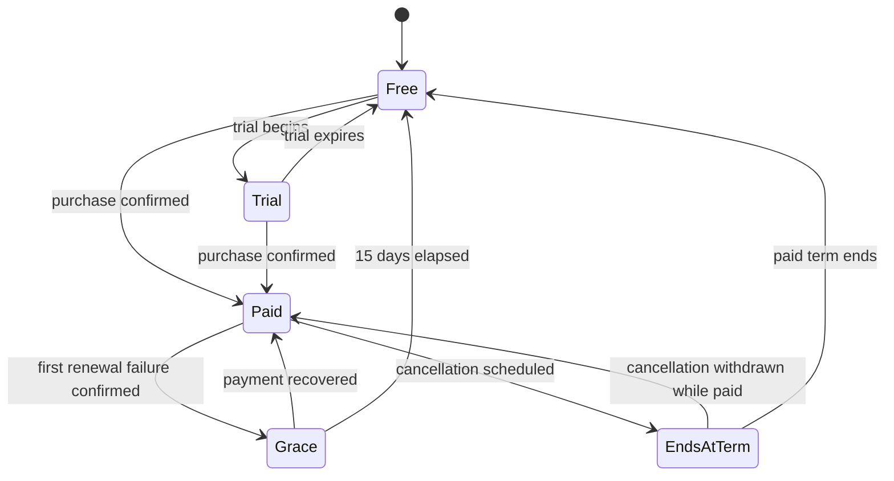

# ADR 0005 — Commercial billing and entitlement boundaries

Status — Product direction confirmed for the free allowance, downgrade order and
renewal grace. Shared-account administration, operational policies, pricing
and provider selection are proposed or pending as indicated below.

## Pricing model and plans

Target the United States and Canada. A billing account has one included business
and three included user seats per business on the free plan. Additional linked
businesses and additional seats require paid capacity. The first paying
customer segment and any beta conversion discount are open. Before setting
prices, compare observed beta use, demand for extra businesses and seats,
willingness to pay, and the cost to operate and support them. Under a flat
per-payer model, extra businesses and seats would have no marginal charge.
Under per-business billing, each business could have its own full subscription
and renewal. Seat-only billing would leave business count unpriced. The
included-business and seat allowances with paid additions match the chosen
product direction and keep each extra charge tied to the capacity it buys.

| Access | Business and seat limits | Features and conditions |
| --- | --- | --- |
| Current free beta | Existing admission and workspace policies | Existing staging and production capabilities, including current beta-specific restrictions. Billing is independent of beta admission. |
| Trial | Limits and duration pending | The currently deployed feature set. A transition to paid requires an explicit purchase. |
| Free, including a return from paid | One editable business and up to three seats per linked business | Extra linked businesses are read-only for seated members whose roles allow reading. Excess users lose access to that business. Existing export authority is preserved for eligible members. |
| Paid | Included capacity and purchased additions reflected in an internal plan version | Includes planned mixed-use asset depreciation, mileage batch editing, export and permanent deletion, and mixed-use expense batch editing when those features ship. Ledger currency remains set on each business. |

### Applying the free limits

The first active business link by server-recorded link time stays eligible for
editing. For each linked business, rank active owners first, admins next, and
other active members together, with earlier membership join times first in each
group. The first three are seated, including when owners and admins exceed
three. Pending invitations and disabled users do not occupy seats. Break equal
timestamps with stable organization or user IDs. A billing owner has no manual
selection of the free business or seats. These selections cap access. The
existing [authorization policy](../identity/AUTHORIZATION.md) still determines
which actions each seated member can take, including bookkeeping export.

## Subscription lifecycle

Use the first confirmed failed renewal for the current delinquency period as
the grace start. Retries of the same renewal preserve that start. Grace ends
after 15 elapsed days, measured in UTC, with free limits effective at the
deadline. Scheduled cancellation keeps the paid allowance through the paid
term. A fresh confirmed purchase can restore paid eligibility. The treatment of
pause, refunds, disputes, and overlapping scheduled cancellation and failed
renewal needs review before those provider states drive access.

Pending payment, checkout returns, and unverified provider events are advisory.
Reconcile authoritative provider state before expanding or reducing access.
The proposed outage rule is to use the last verified paid term and any already
established grace deadline, preserve read and export access, and route an
unconfirmed renewal for reconciliation. Approval is still needed for edit
access when a known term ends during a prolonged outage. Billing cancellation
and account closure are separate workflows. Billing changes preserve business
records and receipts. The [customer lifecycle policy](../operations/CUSTOMER_LIFECYCLE.md)
continues to govern closure, export, and retention.

## Shared billing account

Introduce a stable billing-account ID with its own payer authority and
explicit links to organizations. Each organization has at most one active
billing link. The account owns the commercial subscription and purchased
capacity. The organization owns business membership, permissions, and its
ledger. One payer can cover several independently permissioned organizations.
Account control confers authority over payment and subscription details.
Existing membership and [organization authority](0003-commercial-identity-and-tenancy.md)
continue to determine business access. The proposed first-release rule requires
approval from the payer and an active owner of each organization to add a link.
When one person holds both authorities, that person can confirm both. Linking,
unlinking, payer transfer, and audit contracts need maintainer review before
the write path.

Revision `0027_billing_storage` already owns organization-bound customer
identity, immutable plan versions, provider-scoped event identity, and
append-only subscription history. The shared-account migration must decide how
those organization-bound records relate to an account-wide subscription. Use
stable internal IDs independently of provider identifiers, and retain the
existing organization-scoped protections. Apply verified receipt deduplication,
the subscription update, and history insertion in one PostgreSQL transaction
for each applied event. The adapter verifies events and supplies normalized
provider facts. The application owns the entitlement decision. Existing durable
jobs can support bounded reconciliation when provider state is uncertain.

Revision `0028_billing_account_links` stores the shared payer identity, one
active link per organization, and server-recorded membership timestamps.
Role changes preserve the join date. The dormant implementation uses the new
activation timestamp when someone rejoins. Existing active members with
unknown dates keep their access, and the billing repository reports the
business's seat calculation as unavailable pending a reliable ordering.
Invitation creation and user registration precede membership and cannot
establish when someone joined a business. The provider-independent policy
uses the selected business's roster and its account's link order. Runtime
authorization continues to use the existing policy until a billing enrollment
path and these rollout rules are approved.

## Provider shortlist and setup

| Candidate | Published baseline and operational tradeoff |
| --- | --- |
| Stripe Payments + Billing | Direct processing gives the operator control of the merchant account and payout and dispute workflow. US standard domestic card pricing lists 2.9% + $0.30, with 0.7% pay-as-you-go Billing added. Tax Basic is a separate option. Understand and arrange registration, filing and remittance for the chosen legal setup. USD/CAD presentment, settlement and cross-border fees depend on account and payment setup. Checkout, a hosted portal, and webhook-driven subscription state are available. [Pricing](https://stripe.com/pricing) · [Currencies](https://docs.stripe.com/currencies) · [Tax registration](https://docs.stripe.com/tax/registering) · [Portal](https://docs.stripe.com/customer-management) |
| Paddle Billing | Merchant of record with advertised checkout pricing of 5% + $0.50. Paddle handles transaction tax collection and remittance for supported sales and manages buyer payment support and chargebacks. Verify business approval, refunds, payout and FX terms, and plan-change constraints. USD and CAD are supported payment currencies. Paddle provides checkout, a hosted portal, and a sandbox with different retry and recovery behavior from live. [Pricing](https://www.paddle.com/pricing) · [Currencies](https://developer.paddle.com/concepts/sell/supported-currencies/) · [Sandbox](https://developer.paddle.com/sdks/sandbox/) · [Portal](https://developer.paddle.com/build/customers/integrate-customer-portal/) |

For comparison, a hypothetical US$20 domestic renewal incurs US$1.02 for
Stripe Payments plus Billing at those rates, or US$1.50 for Paddle Checkout.
This example excludes taxes, any separate tax service fee, cross-border and FX
fees, refunds and disputes. Use current account-specific terms and expected
payment volume when approving a provider. This is a processing-cost comparison
and supplies no customer price.

Both providers document duplicate and out-of-order webhook delivery. Store
provider-scope event IDs and retrieve authoritative state for ambiguous changes.
The sandbox should exercise checkout, portal, term-end cancellation, failed
renewal, out-of-order callbacks, recovery and provider outage.
[Stripe webhooks](https://docs.stripe.com/webhooks) ·
[Paddle webhooks](https://developer.paddle.com/webhooks/about/how-webhooks-work/)

Setup checkpoints are owner selection of provider and operator entity, approval
of USD/CAD payment and payout terms, tax/legal and refund decisions, separate
test and live provider accounts or environments, provider catalog mappings
to internal plan versions, authorized portal and return URLs, dedicated
signature secrets in approved secret custody, and staged reconciliation and
recovery exercises. Use provider-hosted payment collection. Handle raw request
data transiently for verification and persist only necessary provider
references and sanitized billing facts. Live-mode configuration and charging
require separate launch approval.
